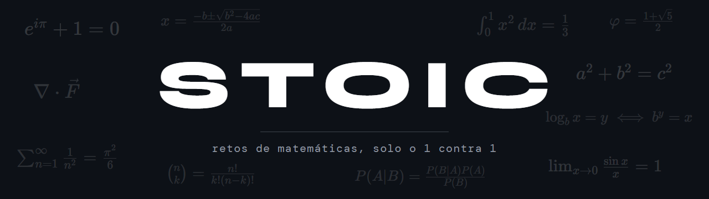
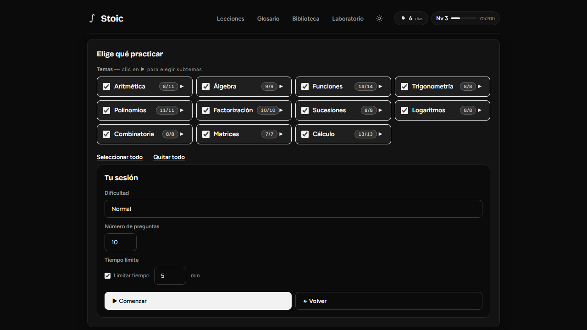
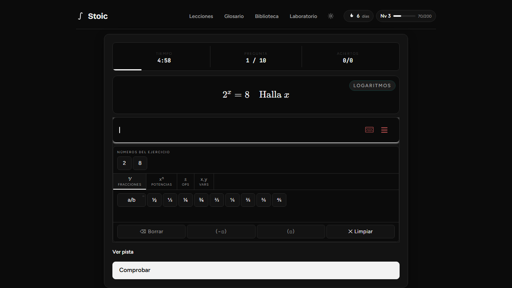
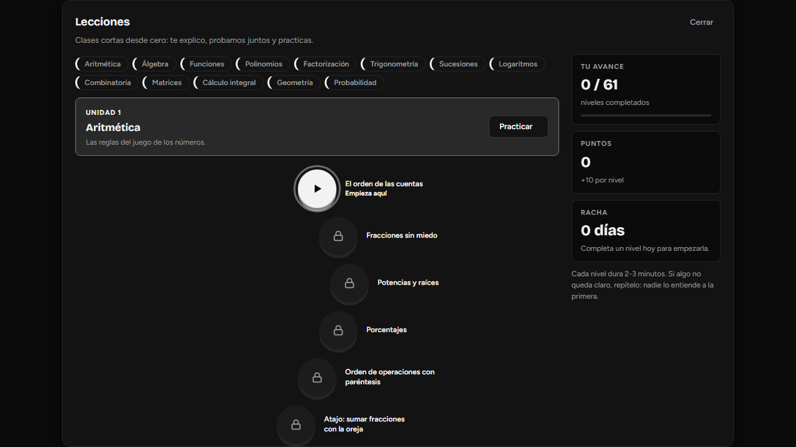
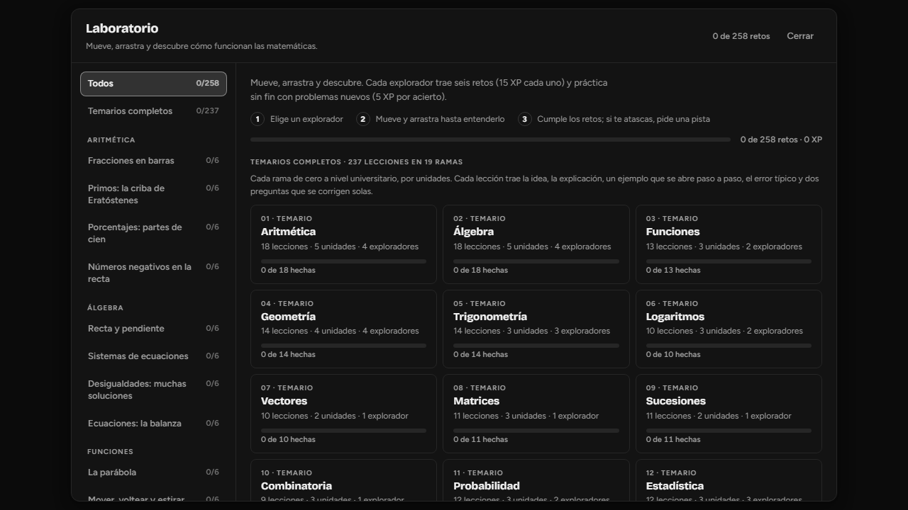
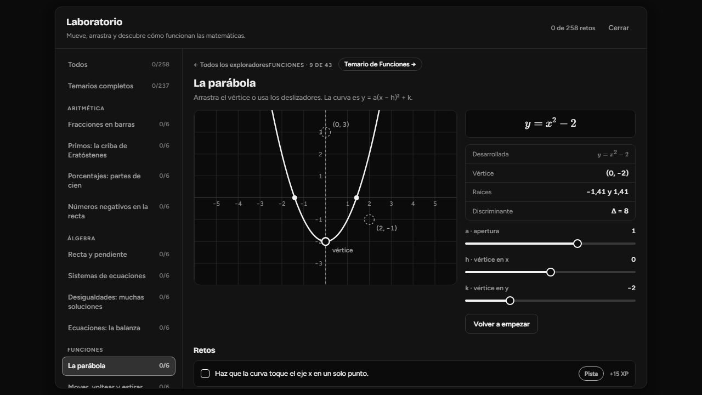
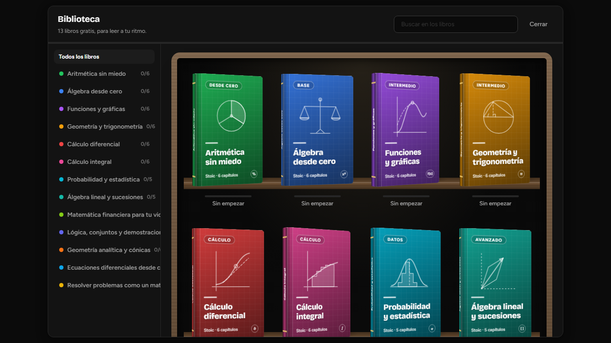
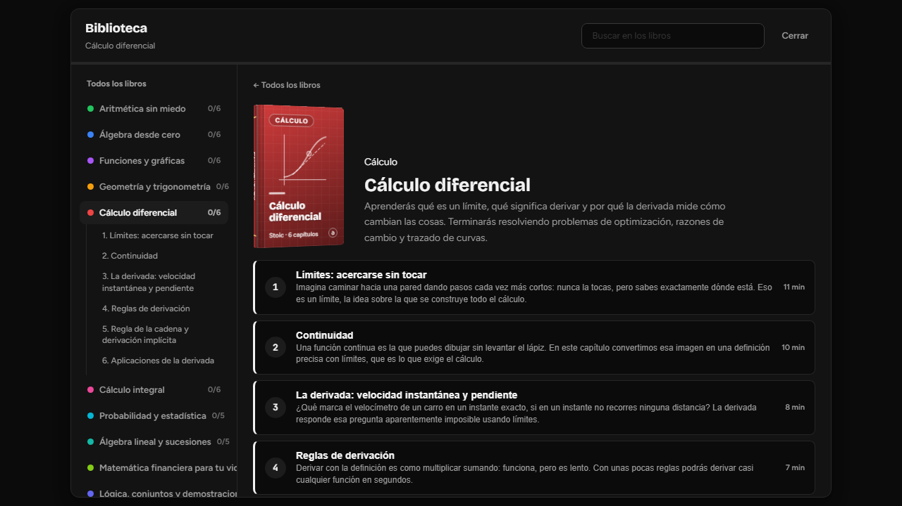
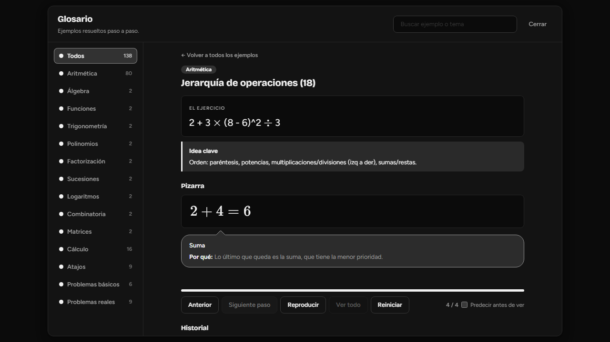

  
  

  
  

<h3 align="center">
  <a href="https://github.com/Losif24/stoic/releases/latest">Descargar para Windows</a>
</h3>

Stoic es una app de escritorio para practicar matemáticas. Los ejercicios se generan al azar, así que no se acaban, y se juega solo o 1 contra 1 con otra persona. Para estudiar desde cero trae lecciones, un laboratorio con 43 exploradores que se manejan arrastrando, un curso de cálculo integral, 13 libros y un glosario de 138 ejemplos resueltos. Una vez instalada no necesita internet, salvo para jugar contra alguien que no esté en tu red y para bajar actualizaciones.

## Qué hay dentro

| Sección | Qué encuentras |
|---|---|
| **Jugar solo** | 11 temas y 107 subtemas, 7 dificultades (de Base a Erudito), las preguntas que quieras y tiempo límite opcional. Se responde con un teclado matemático en pantalla. |
| **1 contra 1** | Creas una sala, pasas el código y la partida va directa entre los dos equipos por WebRTC. |
| **Lecciones** | 13 rutas con 61 niveles de 2 a 3 minutos. Cada nivel se abre al terminar el anterior. |
| **Laboratorio** | 43 exploradores con 6 retos cada uno (258 en total), práctica sin fin y 19 temarios con 237 lecciones. |
| **Cálculo integral** | Un curso dentro del laboratorio: 10 unidades y 48 lecciones, desde la idea de área hasta Simpson y la probabilidad, con 57 gráficas que se mueven. Cada lección se cierra con 5 preguntas, cada unidad con un reto y el curso con un examen final de 16. |
| **Biblioteca** | 13 libros y 76 capítulos, con buscador y progreso por libro. |
| **Glosario** | 138 ejemplos resueltos que se muestran paso a paso en una pizarra. |

## Capturas

<table>
  <tr>
    <td width="50%">
<b>Jugar solo · temas, dificultad y tiempo</b>
</td>
    <td width="50%">
<b>Una pregunta con el teclado matemático</b>
</td>
  </tr>
  <tr>
    <td width="50%">
<b>Lecciones · ruta por niveles</b>
</td>
    <td width="50%">
<b>Laboratorio · los 19 temarios</b>
</td>
  </tr>
  <tr>
    <td width="50%">
<b>Laboratorio · la parábola con deslizadores</b>
</td>
    <td width="50%">
<b>Biblioteca · 13 libros</b>
</td>
  </tr>
  <tr>
    <td width="50%">
<b>Biblioteca · capítulos de un libro</b>
</td>
    <td width="50%">
<b>Glosario · un ejemplo resuelto en la pizarra</b>
</td>
  </tr>
</table>

## Progreso

La racha cuenta los días seguidos que juegas. Cada acierto da 10 XP, terminar una partida suma 5 y cada reto del laboratorio vale 15. En el curso de cálculo integral, dominar una lección da 20 y superar una unidad, 40. Un nivel son 200 XP. Todo se guarda en tu equipo, sin cuenta ni registro.

## Instalación

1. Descarga `StoicSetup-x.y.z.exe` desde [Releases](https://github.com/Losif24/stoic/releases/latest).
2. Ejecútalo. Se instala para tu usuario y no pide permisos de administrador.
3. Si Windows muestra «Windows protegió su PC», es porque el instalador no está firmado. Pulsa «Más información» y luego «Ejecutar de todas formas».

Desde la 1.1.0 se actualiza sola: al abrirla mira si hay versión nueva, la descarga y se reinicia cuando no estás en mitad de una partida. Si tienes la 1.0.0, instala la 1.1.0 a mano una vez.

**Requisitos:** Windows 10 u 11 de 64 bits.

## Jugar 1 contra 1

1. Quien crea la sala pulsa **Crear sala**. La app abre un servidor local en el puerto 8080 (si está ocupado, prueba hasta el 8089) y muestra el código.
2. La otra persona escribe ese código y la dirección del anfitrión, y pulsa **Unirse**.
3. En la misma red basta con la IP local. Por internet puedes abrir el puerto en el router, o usar [ngrok](https://ngrok.com): si lo tienes instalado, la app abre el túnel sola.

Si no conecta, revisa que el cortafuegos de Windows deje pasar a Stoic y que los dos tengan la misma versión.

## Atajos

| Tecla | Acción |
|---|---|
| <kbd>Ctrl</kbd> + <kbd>+</kbd> · <kbd>Ctrl</kbd> + <kbd>-</kbd> | Acercar y alejar |
| <kbd>Ctrl</kbd> + <kbd>0</kbd> | Tamaño original |

## Tecnologías

Electron 40 · JavaScript · KaTeX · MathLive · mathjs · WebRTC con simple-peer

---

Desarrollado por Losif24.

